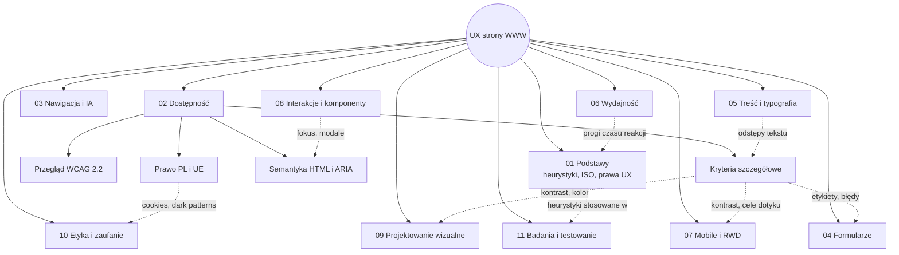

# 🧭 Baza wiedzy: UX stron internetowych

Uporządkowany zbiór **konkretnych, źródłowo udokumentowanych wytycznych** dotyczących projektowania doświadczeń użytkownika (UX) na stronach internetowych: dobre praktyki, dostępność (WCAG 2.2), wymogi prawne PL/UE, formularze, nawigacja, treść, wydajność, mobile, etyka i badania.

> [!IMPORTANT]
> **Każda wytyczna ma powołanie na źródło** (norma, specyfikacja, akt prawny, badanie lub publikacja uznanej organizacji badawczej). Wszystkie treści przeszły weryfikację faktów – zob. [raporty weryfikacji](weryfikacja/).

---

## 📑 Spis treści

- [Mapa wiedzy](#-mapa-wiedzy)
- [Struktura repozytorium](#-struktura-repozytorium)
- [Autorski Skill dla Agentów AI (Audyt Jedną Komendą)](#-autorski-skill-dla-agentów-ai-audyt-jedną-komendą)
- [Jak korzystać z bazy](#-jak-korzystać-z-bazy)
- [System identyfikatorów](#-system-identyfikatorów)
- [Ścieżki czytania wg roli](#-ścieżki-czytania-wg-roli)
- [Hierarchia wiarygodności źródeł](#-hierarchia-wiarygodności-źródeł)
- [Weryfikacja i aktualność](#-weryfikacja-i-aktualność)
- [Współtworzenie](#-współtworzenie)

---

## 🗺 Mapa wiedzy



### Tabela rozdziałów

| # | Rozdział | Plik | Prefiks ID | Kluczowe źródła |
|---|----------|------|-----------|-----------------|
| 01 | Podstawy: heurystyki, normy, prawa UX | [heurystyki-i-prawa-ux.md](docs/01-podstawy/heurystyki-i-prawa-ux.md) | `POD` | ISO 9241, Nielsen, Fitts, Hick, Miller |
| 02a | Dostępność – przegląd WCAG 2.2 | [wcag-2-2-przeglad.md](docs/02-dostepnosc/wcag-2-2-przeglad.md) | `DOST-01…09` | W3C WCAG 2.2, WebAIM, WHO |
| 02b | Dostępność – kryteria szczegółowe | [wcag-kryteria-szczegolowe.md](docs/02-dostepnosc/wcag-kryteria-szczegolowe.md) | `DOST-10…` | W3C Understanding WCAG 2.2 |
| 02c | Dostępność – prawo PL/UE | [prawo-pl-ue.md](docs/02-dostepnosc/prawo-pl-ue.md) | `PRAW` | Dz.U., EUR-Lex, EN 301 549 |
| 02d | Semantyczny HTML i WAI-ARIA | [semantyka-html-aria.md](docs/02-dostepnosc/semantyka-html-aria.md) | `ARIA` | W3C Using ARIA, ARIA APG |
| 03 | Nawigacja i architektura informacji | [nawigacja-i-ia.md](docs/03-nawigacja-i-architektura-informacji/nawigacja-i-ia.md) | `NAW` | NN/g, Baymard, W3C |
| 04 | Formularze | [formularze.md](docs/04-formularze/formularze.md) | `FORM` | Baymard, GOV.UK, NN/g, NIST |
| 05 | Treść, czytelność i typografia | [tresc-i-typografia.md](docs/05-tresc-i-typografia/tresc-i-typografia.md) | `TRE`, `TYP` | ISO 24495-1, GOV.UK, WCAG 1.4.8 |
| 06 | Wydajność i Core Web Vitals | [wydajnosc-core-web-vitals.md](docs/06-wydajnosc/wydajnosc-core-web-vitals.md) | `WYD` | web.dev (Google) |
| 07 | Mobile i responsywność | [mobile-i-responsywnosc.md](docs/07-mobile-i-responsywnosc/mobile-i-responsywnosc.md) | `MOB` | WCAG 2.5.8, Apple HIG, Material |
| 08 | Interakcje i komponenty | [interakcje-i-komponenty.md](docs/08-interakcje-i-komponenty/interakcje-i-komponenty.md) | `INT` | NN/g, ARIA APG, Material |
| 09 | Projektowanie wizualne | [projektowanie-wizualne.md](docs/09-projektowanie-wizualne/projektowanie-wizualne.md) | `WIZ` | NN/g, Material, NEI |
| 10 | Etyka, zaufanie, prywatność | [etyka-i-zaufanie.md](docs/10-etyka-i-zaufanie/etyka-i-zaufanie.md) | `ETY` | RODO, DSA, EDPB, Stanford |
| 11 | Badania i testowanie | [badania-i-testowanie.md](docs/11-badania-i-testowanie/badania-i-testowanie.md) | `BAD` | NN/g, ISO, W3C WCAG-EM |
| ✅ | Checklista wdrożeniowa | [CHECKLISTA.md](CHECKLISTA.md) | — | odwołania do ID |
| 🤖 | Skill AI: Audyt UX jedną komendą | [SKILL.md](.agents/skills/ux-audit-checklista/SKILL.md) | — | 59 kryteriów + skaner Python |
| 📚 | Wykaz źródeł | [ZRODLA.md](ZRODLA.md) | — | — |

---

## 📂 Struktura repozytorium

```text
.
├── README.md                     ← jesteś tutaj (mapa wiedzy i instrukcja)
├── CHECKLISTA.md                 ← skrócona lista kontrolna z odnośnikami do wytycznych
├── ZRODLA.md                     ← wykaz źródeł pogrupowany wg typu i wiarygodności
├── CONTRIBUTING.md               ← zasady dodawania i aktualizowania wytycznych
├── .agents/
│   └── skills/
│       └── ux-audit-checklista/  ← autorski skill dla agentów AI (audyt UX i WCAG jedną komendą)
│           ├── SKILL.md
│           ├── scripts/audit_scanner.py
│           └── references/
├── docs/
│   ├── 01-podstawy/
│   ├── 02-dostepnosc/            ← 4 pliki: przegląd, kryteria, ARIA, prawo
│   ├── 03-nawigacja-i-architektura-informacji/
│   ├── 04-formularze/
│   ├── 05-tresc-i-typografia/
│   ├── 06-wydajnosc/
│   ├── 07-mobile-i-responsywnosc/
│   ├── 08-interakcje-i-komponenty/
│   ├── 09-projektowanie-wizualne/
│   ├── 10-etyka-i-zaufanie/
│   └── 11-badania-i-testowanie/
└── weryfikacja/                  ← raporty weryfikacji faktów (status każdej wytycznej)
```

---

## 🤖 Autorski Skill dla Agentów AI (Audyt Jedną Komendą)

Repozytorium zawiera gotowy skill [`.agents/skills/ux-audit-checklista/`](.agents/skills/ux-audit-checklista/SKILL.md) zgodny ze standardem Antigravity / Claude Code / Cursor, który pozwala przeprowadzić kompleksowy audyt UX i dostępności (WCAG 2.2 AA) dowolnej strony internetowej **jedną komendą**:

```text
/ux-audit-checklista <ścieżka_lub_URL> "Persona: <opis persony>"
```

Skill automatycznie:
1. Tworzy profil **Persony badawczej** i planuje ścieżkę pokrywającą **100% ekranów/widoków**,
2. Uruchamia skaner techniczny [`audit_scanner.py`](.agents/skills/ux-audit-checklista/scripts/audit_scanner.py) (mierzący kontrasty WCAG 2.2, semantykę HTML/ARIA, obrazy i higienę produkcyjną),
3. Generuje zrzuty ekranu każdego etapu ścieżki użytkownika,
4. Weryfikuje wszystkie **59 punktów z [`CHECKLISTA.md`](CHECKLISTA.md)** ([pełna matryca 59 kryteriów](.agents/skills/ux-audit-checklista/references/checklista-59-kryteriow.md)),
5. Zestawia listę błędów z wagami (**Severity 1–4**) i gotowym kodem naprawczym (**Proponowane Fixy**) w formatach `.md`, `.html` oraz `.docx` (gotowym do importu w Canva Docs).

---

## 🧑‍💻 Jak korzystać z bazy

1. **Szukasz odpowiedzi na konkretne pytanie?** Użyj wyszukiwarki GitHuba w repozytorium (klawisz `/` lub `t` dla plików) z hasłem, np. `kontrast`, `placeholder`, `INP`, `cookies`. Możesz też szukać po numerze kryterium WCAG, np. `2.5.8`.
2. **Projektujesz lub audytujesz stronę?** Zacznij od [CHECKLISTA.md](CHECKLISTA.md) – każdy punkt prowadzi do pełnej wytycznej z uzasadnieniem i źródłem.
3. **Chcesz zrozumieć temat?** Wybierz rozdział z [mapy wiedzy](#-mapa-wiedzy). Każdy plik ma na górze zakres i prefiks ID, a każda wytyczna – opis, często „Jak sprawdzić” i sekcję **Źródła**.
4. **Chcesz zacytować wytyczną?** Podawaj jej ID (np. „zgodnie z FORM-04”) – ID są stałe i nie zmieniają się przy edycji treści.
5. **Odsyłacze** między rozdziałami mają postać ID z linkiem (np. [DOST-17](docs/02-dostepnosc/wcag-kryteria-szczegolowe.md)) – w każdym pliku jest link „← Powrót do README”.

### Anatomia wytycznej

```markdown
### FORM-04 Każde pole ma widoczną, trwałą etykietę     ← ID + krótka reguła
Opis: co, dlaczego, z jakimi wartościami progowymi.      ← konkret, liczby
**Jak sprawdzić:** ...                                   ← (opcjonalnie) metoda weryfikacji
**Źródła:** [nazwa źródła](URL) ; ...                     ← obowiązkowo
```

### Oznaczenia poziomu wymagań

| Oznaczenie w treści | Znaczenie |
|---|---|
| **SC x.y.z (A / AA)** | Wymóg WCAG 2.2 – w PL/UE obowiązkowy dla podmiotów objętych prawem (poziomy A i AA) |
| **(AAA)** | Poziom rozszerzony WCAG – zalecenie, nie wymóg |
| „zalecenie”, „dobra praktyka” | Wytyczna oparta na badaniach (NN/g, Baymard itd.) lub uznanych systemach projektowych |
| > [!CAUTION] / > [!NOTE] | Zastrzeżenia: np. charakter informacyjny (nie porada prawna), ograniczenia danych |

---

## 🔖 System identyfikatorów

| Prefiks | Obszar | Prefiks | Obszar |
|---|---|---|---|
| `POD` | Podstawy i heurystyki | `TYP` | Typografia |
| `DOST` | Dostępność / WCAG | `WYD` | Wydajność |
| `PRAW` | Prawo PL/UE | `MOB` | Mobile i responsywność |
| `ARIA` | Semantyka HTML i ARIA | `INT` | Interakcje i komponenty |
| `NAW` | Nawigacja i IA | `WIZ` | Projektowanie wizualne |
| `FORM` | Formularze | `ETY` | Etyka i zaufanie |
| `TRE` | Treść i prosty język | `BAD` | Badania i testowanie |

Numeracja jest ciągła w obrębie prefiksu; usunięte ID nie są ponownie wykorzystywane.

---

## 🎯 Ścieżki czytania wg roli

| Rola | Zalecana kolejność |
|---|---|
| **Projektant/ka UX/UI** | 01 → 03 → 04 → 08 → 09 → 05 → 02a/02b → 11 |
| **Front-end developer** | 02a → 02b → 02d → 06 → 07 → 04 → 08 |
| **Copywriter / content designer** | 05 → 03 (etykiety, linki) → 04 (komunikaty błędów) → 02b (DOST-10, DOST-34) |
| **Product owner / manager** | 01 → 02c (prawo) → 10 → 11 → CHECKLISTA |
| **Audytor/ka dostępności** | 02a → 02b → 02d → 02c → BAD-08, BAD-09 |

---

## 🏛 Hierarchia wiarygodności źródeł

Baza korzysta wyłącznie z niżej wymienionych typów źródeł (szczegóły w [ZRODLA.md](ZRODLA.md)):

1. **Normy i specyfikacje** – W3C (WCAG, WAI-ARIA), ISO, ETSI/EN.
2. **Akty prawne i orzecznictwo** – Dz.U. (ISAP), EUR-Lex, TSUE, wytyczne EDPB.
3. **Recenzowane publikacje naukowe** – z numerem DOI.
4. **Uznane organizacje badawcze UX** – Nielsen Norman Group, Baymard Institute, MeasuringU.
5. **Oficjalna dokumentacja platform i systemów projektowych** – web.dev / Google, MDN, Apple HIG, Material Design, GOV.UK Design System.

Statystyki pochodzące z pojedynczych badań komercyjnych są w treści opatrzone zastrzeżeniem.

---

## 🔍 Weryfikacja i aktualność

- Stan wiedzy: **listopad 2026**.
- Każdy rozdział został sprawdzony przez niezależnego agenta weryfikującego (porównanie twierdzeń, liczb, dat i URL-i ze źródłami pierwotnymi). Wyniki – status każdej wytycznej (✅ potwierdzone / ✏️ poprawione / ⚠️ złagodzone / ❌ usunięte) – znajdziesz w katalogu [weryfikacja/](weryfikacja/).
- Obszary szczególnie zmienne, wymagające okresowego przeglądu: wersje WCAG (prace nad WCAG 3.0), EN 301 549, progi Core Web Vitals, przepisy wdrażające EAA, statystyki WebAIM Million (publikowane corocznie).

> [!CAUTION]
> Informacje prawne mają charakter poglądowy i nie stanowią porady prawnej.

---

## 🤝 Współtworzenie

Zasady dodawania wytycznych, wymagania dotyczące źródeł i proces weryfikacji opisuje [CONTRIBUTING.md](CONTRIBUTING.md).

**Licencja:** przed publikacją dodaj plik `LICENSE` (rekomendacja dla treści: [CC BY 4.0](https://creativecommons.org/licenses/by/4.0/deed.pl)). Cytowane fragmenty źródeł pozostają własnością ich autorów.

